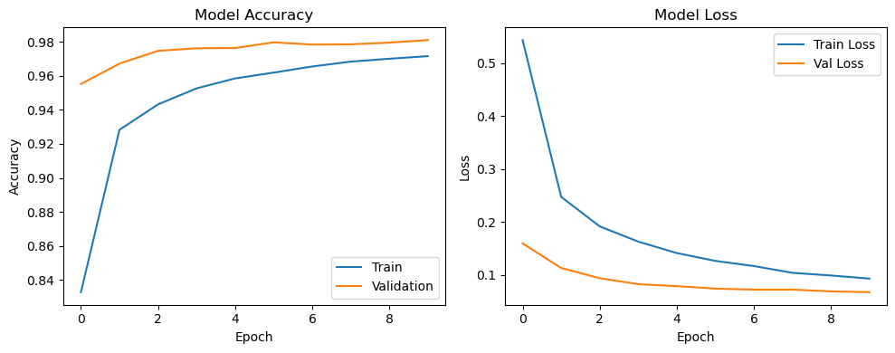

# Handwritten Digit Classifier (MNIST, TensorFlow/Keras)

A neural network that recognises handwritten digits 0–9 from 28×28 images, built as a reusable `MNISTClassifier` class.

## Results

**97.8% accuracy on the 10,000-image test set.** Training compares runs with and without early stopping. The saved model is `mnist_ann_model.keras`.



## What's inside

- `mnist_deep_learning.ipynb`: loading and normalising data, building and training the network, evaluation and a confusion matrix.
- `confusion_matrix.png`, `training_history.png`, `mnist_sample_images.png`: result charts.
- `Deep Learning - Project Report.pdf`: the write-up.

## Tech

Python · TensorFlow / Keras · scikit-learn · NumPy · Matplotlib · Seaborn

## Run

```bash
pip install -r requirements.txt
jupyter notebook mnist_deep_learning.ipynb
```

*Built for the Data & AI programme at Cyber Shujaa, Kenya.*
